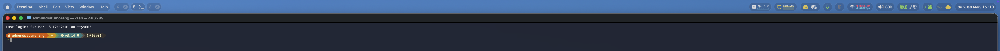

# SketchyBar Config — iOS Frosted Glass Design

A modern, visually stunning SketchyBar configuration featuring an iOS-inspired frosted glass aesthetic with floating island widgets. This config transforms your macOS menu bar into a sleek, contemporary interface that mirrors the design language of recent iPhone themes.

## ✨ Features

- **iOS Frosted Glass Design** — True backdrop blur behind each floating widget island, mimicking the iOS Control Center aesthetic
- **Weather Widget** — Real-time weather with temperature, condition, humidity, wind speed, and location
- **Homebrew Monitor** — Track outdated packages with one-click access to upgrade
- **System Metrics** — CPU, RAM, Disk usage graphs with live updates
- **Status Indicators** — Battery, WiFi, VPN, microphone, volume control
- **Modern Aesthetics** — Cool-toned semi-transparent backgrounds with subtle borders and smooth animations
- **Aerospace Integration** — Workspace management with visual indicators

## 🖼️ Preview



The menu bar features:
- **Left side**: Apple menu + Calendar date/time
- **Right side**: Floating glass islands with weather, Homebrew updates, system metrics (CPU, RAM, Disk), battery, volume, WiFi, VPN, and microphone status
- **Smooth animations** and responsive interactions

## 🚀 Quick Start

### Prerequisites

- macOS 12 or later
- [SketchyBar](https://felixkratz.github.io/SketchyBar/) installed
- [Aerospace](https://github.com/nikitabobko/AeroSpace) (optional, for workspace management)
- Homebrew (optional, for package monitoring)

### Installation

1. **Backup your current config** (if you have one):
   ```bash
   cp -r ~/.config/sketchybar ~/.config/sketchybar.backup
   ```

2. **Clone or download this configuration**:
   ```bash
   git clone https://github.com/YOUR_USERNAME/sketchybar-config ~/.config/sketchybar
   cd ~/.config/sketchybar
   ```

3. **Reload SketchyBar**:
   ```bash
   sketchybar --reload
   ```

## 📋 Configuration Files

```
~/.config/sketchybar/
├── colors.lua              # iOS glass color palette
├── settings.lua            # Global spacing and font settings
├── bar.lua                 # Menu bar appearance and layout
├── default.lua             # Default item styling
├── init.lua                # Initialization and event handlers
├── items/
│   ├── apple.lua          # Apple menu
│   ├── calendar.lua       # Date and time
│   ├── menus.lua          # App menus
│   ├── workspaces.lua     # Aerospace workspace switcher
│   └── widgets/
│       ├── battery.lua    # Battery status with time remaining
│       ├── brew.lua       # Homebrew outdated packages
│       ├── cpu.lua        # CPU usage graph
│       ├── disk.lua       # Disk usage with details
│       ├── mic.lua        # Microphone status
│       ├── ram.lua        # RAM usage graph
│       ├── volume.lua     # Volume control with slider
│       ├── vpn.lua        # VPN connection status
│       ├── weather.lua    # Weather widget
│       └── wifi.lua       # WiFi info and speed
└── plugins/
    └── weather.sh         # External weather API script
```

## 🎨 Glass Design Details

The iOS frosted glass aesthetic is achieved through:

- **Backdrop Blur**: `blur_radius = 20` on all brackets creates a true frosted effect where your wallpaper shows through with blur
- **Color Palette**:
  - Glass: `0x2d1c1c2e` (~18% opacity, cool blue-grey)
  - Border: `0x18ffffff` (~9% white, barely visible)
  - Popup: `0x5e1c1c2e` (~37% opacity)
- **Geometry**: 14px corner radius for rounder, more iOS-like appearance
- **Spacing**: 9px gaps between widget islands for that floating, separated feeling

## ⚙️ Customization

### Change Glass Colors

Edit `colors.lua`:
```lua
glass = 0x2d1c1c2e,           -- Adjust opacity (first two digits) or color
glass_border = 0x18ffffff,    -- Border highlight
popup = { bg = 0x5e1c1c2e }  -- Popup background
```

### Adjust Blur Intensity

In individual widget files (e.g., `items/widgets/battery.lua`):
```lua
blur_radius = 20,  -- Change to 10 for less blur, 30+ for more
```

### Modify Spacing & Layout

Edit `settings.lua`:
```lua
group_paddings = 9,  -- Space between island groups (default: 9)
paddings = 3,        -- Internal item padding (default: 3)
```

### Change Weather Update Frequency

In `items/widgets/weather.lua`:
```lua
update_freq = 1800, -- Update every 30 minutes (1800 seconds)
```

## 🌐 Weather Widget

The weather widget uses the **Open-Meteo API** (free, no API key required):
- Fetches your location via IP-based geolocation
- Shows temperature, "feels like," condition, humidity, and wind speed
- Color-coded temperature display:
  - 🔴 Red: ≥35°C (hot)
  - 🟠 Orange: 28-35°C (warm)
  - 🟡 Yellow: 20-28°C (mild)
  - 🟢 Green: 10-20°C (cool)
  - 🔵 Blue: 0-10°C (cold)
  - 🟣 Magenta: <0°C (freezing)

## 🔧 Troubleshooting

### Weather not updating
- Check internet connection
- Verify `~/.config/sketchybar/plugins/weather.sh` is executable: `chmod +x plugins/weather.sh`
- Check curl is installed: `which curl`

### Homebrew widget shows nothing
- Install Homebrew: `/bin/bash -c "$(curl -fsSL https://raw.githubusercontent.com/Homebrew/install/HEAD/install.sh)"`
- Verify path: `which brew`

### System metrics not showing
- Ensure proper permissions for CPU/RAM monitoring tools
- Check if `vm_stat` and `memory_pressure` are accessible

### Workspace widget empty
- Install Aerospace: `brew install nikitabobko/tap/aerospace`
- Configure Aerospace with your workspace shortcuts

## 📦 Dependencies

Optional but recommended:

```bash
# Install Aerospace for workspace management
brew tap nikitabobko/tap
brew install nikitabobko/tap/aerospace

# Install Homebrew for package monitoring
/bin/bash -c "$(curl -fsSL https://raw.githubusercontent.com/Homebrew/install/HEAD/install.sh)"

# Switch audio source (volume widget enhancement)
brew install switchaudiosource
```

## 🎯 Features Deep Dive

### Battery Widget
- Shows current charge percentage
- Time remaining (or "AC" if charging)
- Color-coded: 🟢 Green (>80%), 🟡 Yellow (20-80%), 🔴 Red (<20%)
- Click to see detailed popup

### Homebrew Widget
- Shows count of outdated packages
- Color-coded: 🟢 Green (0), 🟡 Yellow (5+), 🟠 Orange (10+), 🔴 Red (20+)
- Click to see list of outdated packages
- Right-click to open Terminal with `brew upgrade`

### System Metrics
- **CPU**: Real-time usage graph with percentage
- **RAM**: Memory usage graph with detailed breakdown
- **Disk**: Storage percentage and free space
- Click for more details in popup menus

### Network Status
- **WiFi**: Current SSID, IP address, router, subnet mask
- **Upload/Download**: Real-time network speeds
- Click items to copy to clipboard

### VPN Status
- Automatically detects NordVPN and system VPN connections
- Shows when connected with color indicator
- Click to toggle

## 🎬 Performance

- **Minimal CPU impact**: Event-driven updates, no constant polling
- **Efficient memory use**: Lightweight Lua configuration
- **Smart wake handling**: Delayed weather fetch on system wake to prevent freezing
- **Responsive interactions**: Smooth animations and instant feedback

## 🔄 Updates & Maintenance

To update to the latest version:
```bash
cd ~/.config/sketchybar
git pull origin main
sketchybar --reload
```

## 📝 License

This SketchyBar configuration is provided as-is for personal use and modification.

## 🙏 Credits

- **SketchyBar**: [Felix Kratz](https://github.com/FelixKratz/SketchyBar)
- **Aerospace**: [Nikita Bobko](https://github.com/nikitabobko/AeroSpace)
- **Weather Data**: [Open-Meteo](https://open-meteo.com/)
- **Design Inspiration**: iOS 16+ Control Center and Dynamic Island

## 💬 Support

Found an issue? Have suggestions for improvement?
- Check existing configuration in `colors.lua` and `settings.lua`
- Refer to [SketchyBar documentation](https://felixkratz.github.io/SketchyBar/)
- Test changes with `sketchybar --reload`

Enjoy your beautiful, modern menu bar! 🎨✨
